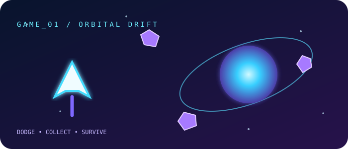
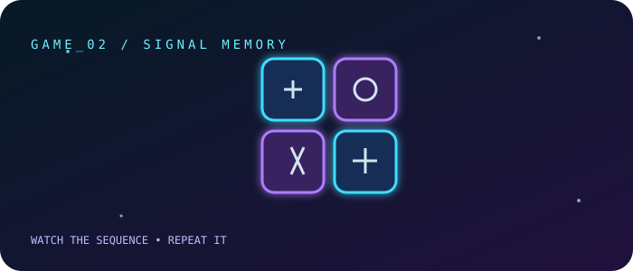

 

## 🌌 `Sujay Mohanty // Profile`

I'm a **B.Tech Artificial Intelligence & Machine Learning student** who enjoys building useful things with Python, computer vision, and machine learning. I like turning ideas into working prototypes — from object detection and OCR to gesture-controlled tools and AI-powered applications.

<table>
<tr>
<td width="50%" valign="top">
<h3>◈ CORE IDENTITY</h3>
<ul>
<li>🎓 B.Tech — Artificial Intelligence &amp; Machine Learning</li>
<li>🧠 Focus: Computer Vision, Deep Learning, Python</li>
<li>🔬 Interested in applied AI and research</li>
<li>🛠️ Prefer learning by building real projects</li>
</ul>
</td>
<td width="50%" valign="top">
<h3>◈ CURRENT MISSION</h3>
<ul>
<li>🔭 Improve AI/ML and computer-vision projects</li>
<li>🌱 Strengthen model deployment and software engineering</li>
<li>👯 Open to thoughtful open-source collaboration</li>
<li>⚡ Keep experimenting, documenting, and iterating</li>
</ul>
</td>
</tr>
</table>

## 🧭 Present Status

<table>
<tr><td>🟢</td><td>Developing practical AI/ML and computer-vision systems</td></tr>
<tr><td>🧪</td><td>Exploring reproducible experiments and research-friendly project ideas</td></tr>
<tr><td>⚙️</td><td>Improving code quality, deployment, and documentation</td></tr>
<tr><td>🌌</td><td>Experimenting with creative interfaces and intelligent applications</td></tr>
</table>

## 🧰 Tech Stack

<b>🌐 Languages & Web</b>

 

<b>🤖 AI, Machine Learning & Computer Vision</b>

 

<b>⚙️ Tools, Databases & Platforms</b>

 

Keep this list aligned with tools you have actually used and can confidently discuss.

## 🚀 Projects & Experiments

<table>
<tr>
<td width="50%" valign="top">
<h3>🪖 Road-Safety / Helmet Detection</h3>

YOLOv8-based computer vision for detecting helmet use and supporting road-safety monitoring.

<code>Python</code> <code>YOLOv8</code> <code>OpenCV</code>

<a href="https://github.com/SujayMohanty?tab=repositories">Browse repositories ↗</a>
</td>
<td width="50%" valign="top">
<h3>🔎 Number-Plate Detection + OCR</h3>

An object-detection and OCR pipeline experiment for locating vehicle number plates and extracting text.

<code>Python</code> <code>YOLO</code> <code>EasyOCR</code>

<a href="https://github.com/SujayMohanty?tab=repositories">Browse repositories ↗</a>
</td>
</tr>
<tr>
<td width="50%" valign="top">
<h3>✋ Hand-Gesture 3D Viewer</h3>

A computer-vision experiment mapping hand movements to interaction with a 3D model viewer.

<code>Python</code> <code>OpenCV</code> <code>Tracking</code>

<a href="https://github.com/SujayMohanty?tab=repositories">Browse repositories ↗</a>
</td>
<td width="50%" valign="top">
<h3>🍩 Doughnut — File Sharing App</h3>

A web-app concept for file uploads and shareable links using authentication, cloud storage, and deployment.

<code>JavaScript</code> <code>Supabase</code> <code>Netlify</code>

<a href="https://github.com/SujayMohanty?tab=repositories">Browse repositories ↗</a>
</td>
</tr>
</table>

<b>➕ More experiments</b>

 
<ul>
<li><b>Gesture-powered photo booth</b> — hand-gesture triggering and camera workflow experiments.</li>
<li><b>Anime desktop overlay</b> — a Python/PyQt experiment with anime information and a desktop overlay interface.</li>
<li><b>AI research explorations</b> — medical-image augmentation and other applied AI ideas.</li>
</ul>

## 🎮 Interactive Mini-Arcade

A small playable corner of my profile. Open the game hub for two browser games built with plain HTML, CSS, Canvas, and JavaScript—no installation required.

<table>
<tr>
<td width="50%" valign="top">

<h3>🛰️ Orbital Drift</h3>

Dodge drifting asteroids, collect energy orbs, and push your high score higher.

</td>
<td width="50%" valign="top">

<h3>🧠 Signal Memory</h3>

Watch the glowing sequence, then repeat it without making a mistake. Each round adds another signal.

</td>
</tr>
</table>

GitHub README pages don't execute arbitrary JavaScript, so the mini-games are hosted on GitHub Pages and launched from these cards. See <code>site/</code> in this repository for the full source.

## 📡 GitHub Dashboard

 

These cards are served by external stats services. If one service is temporarily unavailable, the rest of the profile and GitHub's native contribution calendar still work.

## 🐍 Contribution Snake Protocol

The snake is an animated visualization of your GitHub contribution grid—not a playable JavaScript game inside Markdown. The included Actions workflow generates the light and dark snake SVGs and publishes them to the <code>output</code> branch. If the image is missing after setup, run <b>Actions → Generate cosmic header and contribution snake → Run workflow</b>.

## 🏆 Achievements & Certifications

<b>🏅 LinkedIn — Licenses & Certifications (10 credentials)</b>

 

Source: <a href="https://www.linkedin.com/in/sujay-santanu-mohanty-b3180a383">Sujay's LinkedIn profile</a>. Credential IDs are shown where available.

<table>
<tr>
<td width="50%" valign="top">
<strong>AI-ML Virtual Internship</strong> 
 
Issued Mar 2026 
<code>4f7894729e57dd588434</code>
</td>
<td width="50%" valign="top">
<strong><a href="https://www.hackerrank.com/certificates/A8C13FD9331F">REST API (Intermediate)</a></strong> 
 
Issued Feb 2026 
<code>A8C13FD9331F</code>
</td>
</tr>
<tr>
<td width="50%" valign="top">
<strong>AI Fundamentals: Language & Vision in AI</strong> 
 
Issued Feb 2026
</td>
<td width="50%" valign="top">
<strong><a href="https://www.hackerrank.com/certificates/A96932E03EDF">Python (Basic)</a></strong> 
 
Issued Jan 2026 
<code>A96932E03EDF</code>
</td>
</tr>
<tr>
<td width="50%" valign="top">
<strong><a href="https://www.hackerrank.com/certificates/24223D913430">Software Engineer</a></strong> 
 
Issued Jan 2026 
<code>24223D913430</code>
</td>
<td width="50%" valign="top">
<strong><a href="https://www.hackerrank.com/certificates/8D8BA1C7CD3E">SQL (Basic)</a></strong> 
 
Issued Jan 2026 
<code>8D8BA1C7CD3E</code>
</td>
</tr>
<tr>
<td width="50%" valign="top">
<strong>Introduction to Artificial Intelligence</strong> 
 
Issued Jan 2026 
<code>ALM-COURSE_4058918</code>
</td>
<td width="50%" valign="top">
<strong><a href="https://coursera.org/verify/5B60GEGO7GTN">Crash Course on Python</a></strong> 
 
Issued Sep 2024 
<code>5B60GEGO7GTN</code>
</td>
</tr>
<tr>
<td width="50%" valign="top">
<strong>Fundamentals of AI (EDU-100)</strong> 
 
Valid May 2026 – May 2028 
<code>uonz4y9xj59m</code>
</td>
<td width="50%" valign="top">
<strong>Fundamentals of AI Security (EDU-111)</strong> 
 
Valid May 2026 – May 2028 
<code>nd3cs9mg999w</code>
</td>
</tr>
</table>

<b>🛡️ Additional programme shared in LinkedIn activity</b>

 

<strong>120-Hour Security Analyst Certification Programme</strong> — Reliance Foundation Skilling Academy through Skill India Digital Hub, in collaboration with NSDC International. This was announced as completed in LinkedIn activity; it is kept separate from the formal Licenses &amp; Certifications list.

<b>🎯 Highlights & milestones</b>

 
<ul>
<li>AI/ML and computer-vision project work</li>
<li>Hands-on experimentation across Python, desktop apps, and web development</li>
<li>Add future research publications, hackathons, awards, and other verifiable accomplishments here</li>
</ul>

## 🛰️ End of Transmission

**Thanks for visiting. Keep learning, keep building, and make the next version better.** ✨

