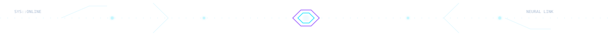

 

##🌌 `Sujay Mohanty? Yep that's ME`

I am an Artificial Intelligence and Machine Learning enthusiast with a a growing interest in Python and an ever-growing passion for building intelligent, real-world solutions. Currently pursuing my B.Tech at GIET University, I enjoy exploring the intersection of technology, logic, and creativity.

Beyond academics, I bring proven leadership and team management experience, having coordinated teams and delivered results under pressure. As an Inter-district level debate champion, I possess strong communication, analytical thinking, and public-speaking skills allowing me to articulate complex ideas with clarity and confidence.
I also have hands-on experience as a game tester, where attention to detail, problem-solving, and user-centric thinking are key. I constantly seek opportunities to learn, experiment, and collaborate on innovative projects in AI, ML, and emerging technologies.
Actively looking to connect, collaborate, and grow with like-minded professionals, mentors, and innovators.

<table>
<tr>
<td width="50%" valign="top">
<h3>◈ CORE IDENTITY</h3>
<ul>
<li>🎓 B.Tech — Artificial Intelligence &amp; Machine Learning</li>
<li>🧠 Focus: Computer Vision, Deep Learning, Python,LLM,NLP,AIAC</li>
<li>🔬 Interested in applied AI, Machine Training and Testing and research</li>
<li>🛠️ Prefer learning by building real projects</li>
</ul>
</td>
<td width="50%" valign="top">
<h3>◈ CURRENT MISSION</h3>
<ul>
<li>🔭 Explore how vast and deep the world of ML can be carried forwaord to</li>
<li>🌱 Strengthen model development and Unbiased reviews for reinforcement</li>
<li>👯 Open to thoughtful open-source collaboration</li>
<li>⚡ Keep experimenting, documenting, and iterating</li>
</ul>
</td>
</tr>
</table>

## 🧭 Present Status

<table>
<tr><td>🟢</td><td>Developing and Exploring Self</td></tr>
<tr><td>🧪</td><td>Exploring reproducible experiments and research-friendly project ideas</td></tr>
<tr><td>🌌</td><td>Experimenting with creative interfaces and intelligent applications</td></tr>
</table>

## 🧰 Tech Stack

<b>🌐 Languages & Web</b>

 

<b>🤖 AI, Machine Learning, Computer Vision, LLMs, NLPs, Box-Bridging, Dijkstra and Greedy Approach </b>

 

### 🧠 AI, Machine Learning & Computer Vision

### 💻 Programming Languages

### 🌐 Web Development & UI

### 🗄️ Databases, Cloud & Deployment

### 🛠️ Developer Tools & Version Control

### 🎮 Creative Coding & Interactive Projects

<b>⚙️ Tools, Databases & Platforms</b>

 

Keep this list aligned with tools you have actually used and can confidently discuss.

## 🚀 Projects & Experiments

<table>
<tr>
<td width="50%" valign="top">
<h3>🪖 Road-Safety / Helmet Detection</h3>

YOLOv8-based computer vision for detecting helmet use and supporting road-safety monitoring.

<code>Python</code> <code>YOLOv8</code> <code>OpenCV</code>

<a href="https://github.com/SujayMohanty?tab=repositories">Browse repositories ↗</a>
</td>
<td width="50%" valign="top">
<h3>🔎 Number-Plate Detection + OCR</h3>

An object-detection and OCR pipeline experiment for locating vehicle number plates and extracting text.

<code>Python</code> <code>YOLO</code> <code>EasyOCR</code>

<a href="https://github.com/SujayMohanty?tab=repositories">Browse repositories ↗</a>
</td>
</tr>
<tr>
<td width="50%" valign="top">
<h3>✋ Hand-Gesture 3D Viewer</h3>

A computer-vision experiment mapping hand movements to interaction with a 3D model viewer.

<code>Python</code> <code>OpenCV</code> <code>Tracking</code>

<a href="https://github.com/SujayMohanty?tab=repositories">Browse repositories ↗</a>
</td>
<td width="50%" valign="top">
<h3>🍩 Doughnut — File Sharing App</h3>

A web-app concept for file uploads and shareable links using authentication, cloud storage, and deployment.

<code>JavaScript</code> <code>Supabase</code> <code>Netlify</code>

<a href="https://github.com/SujayMohanty?tab=repositories">Browse repositories ↗</a>
</td>
</tr>
</table>

<b>➕ More experiments</b>

 
<ul>
<li><b>Gesture-powered photo booth</b> — hand-gesture triggering and camera workflow experiments.</li>
<li><b>Anime desktop overlay</b> — a Python/PyQt experiment with anime information and a desktop overlay interface.</li>
<li><b>AI research explorations</b> — medical-image augmentation and other applied AI ideas.</li>
</ul>

## 🛰️ GitHub Command Center

  
  

  

  

  

---

## 💻 Languages & Technologies

  

## 🤖 AI / ML & Computer Vision

  
   
  
  
  
  

## 🌐 Full-Stack Development

  

## 🗄️ Database, Cloud & DevOps

  

## 🎮 Creative Development

  

---

  <b>⚡ LEARN. BUILD. EXPERIMENT. REPEAT. ⚡</b>
   
  AI/ML • Computer Vision • Software Engineering • Open Source

### 🐍 Contribution Activity — Snake Edition

  <picture>
    <source media="(prefers-color-scheme: dark)" srcset="https://raw.githubusercontent.com/SujayMohanty/SujayMohanty/output/github-contribution-grid-snake-dark.svg" />
    <source media="(prefers-color-scheme: light)" srcset="https://raw.githubusercontent.com/SujayMohanty/SujayMohanty/output/github-contribution-grid-snake.svg" />
    
  </picture>

## 🏆 Achievements & Certifications

<b>🎓 AI, Machine Learning & Professional Certifications</b>

 

| Certification | Issuer | Verification |
|---|---|---|
| AI-ML Virtual Internship | Google for Developers | [View credential](ADD_GOOGLE_CREDENTIAL_URL) |
| AI Fundamentals: Language and Vision in AI | IBM | [View credential](ADD_IBM_CREDENTIAL_URL) |
| Introduction to Artificial Intelligence | IBM | [View credential](ADD_IBM_AI_CREDENTIAL_URL) |
| Python (Basic) | HackerRank | [Verify certificate](ADD_HACKERRANK_PYTHON_URL) |
| SQL (Basic) | HackerRank | [Verify certificate](ADD_HACKERRANK_SQL_URL) |
| Software Engineer Certification | HackerRank | [Verify certificate](ADD_HACKERRANK_ENGINEER_URL) |
| Rest API (Intermediate) | HackerRank | [Verify certificate](ADD_HACKERRANK_API_URL) |
| Fundamentals of AI (EDU-100) | Zscaler | [View credential](ADD_ZSCALER_AI_URL) |
| Fundamentals of AI Security (EDU-111) | Zscaler | [View credential](ADD_ZSCALER_SECURITY_URL) |
| Crash Course on Python | Google | [View credential](ADD_GOOGLE_PYTHON_URL) |

  

<b>🛡️ Additional programme shared in LinkedIn activity</b>

 

<strong>120-Hour Security Analyst Certification Programme</strong> — Reliance Foundation Skilling Academy through Skill India Digital Hub, in collaboration with NSDC International. This was announced as completed in LinkedIn activity; it is kept separate from the formal Licenses &amp; Certifications list.

<b>🎯 Highlights & milestones</b>

 
<ul>
<li>AI/ML and computer-vision project work</li>
<li>Hands-on experimentation across Python, desktop apps, and web development</li>
<li>Add future research publications, hackathons, awards, and other verifiable accomplishments here</li>
</ul>

## 🛰️ End of Transmission

**Thanks for visiting. Keep learning, keep building, and make the next version better.** ✨

